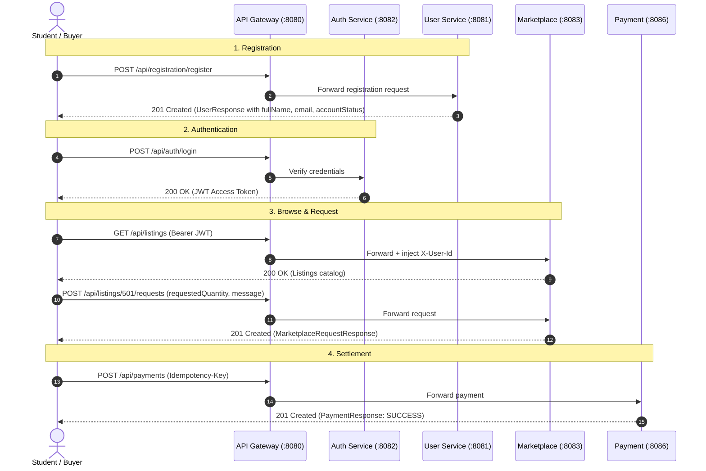
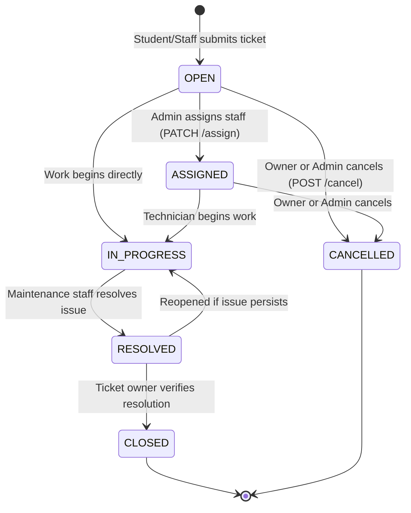

# Vendora Platform — Comprehensive REST API Contract

This document provides the complete, field-accurate REST API contract for the **Vendora Microservices Ecosystem**. It reflects all live DTO models, request headers, query/path parameters, request payloads, response payloads, HTTP status codes, and error schemas.

---

## 1. Global Specifications & Architecture

### 1.1 Base URLs
- **Central API Gateway (Perimeter Entry Point)**: `http://localhost:8080`
- **Eureka Service Registry**: `http://localhost:8761`
- **Unified Centralized Swagger UI**: `http://localhost:8080/swagger-ui/index.html`

### 1.2 Microservice Registry
| Microservice | Port | Route Prefix | Swagger Definition Name |
| :--- | :---: | :--- | :--- |
| **`vendora-auth-service`** | `8082` | `/api/auth/**` | `2. Auth Service` |
| **`vendora-user-service`** | `8081` | `/api/registration/**`, `/api/users/**` | `1. User Service` |
| **`vendora-marketplace-service`** | `8083` | `/api/listings/**` | `3. Marketplace Service` |
| **`vendora-scrap-service`** | `8085` | `/api/scrap/**`, `/api/giveaways/**` | `4. Scrap Service` |
| **`vendora-payment-service`** | `8086` | `/api/payments/**` | `5. Payment Service` |
| **`vendora-helpdesk-service`** | `8084` | `/api/helpdesk/**` | `6. Helpdesk Service` |

---

### 1.3 Security & Identity Propagation
All protected endpoints are routed through the **API Gateway** (`8080`):
1. **Client Authorization Header**:
   ```http
   Authorization: Bearer <jwt-token>
   ```
2. **Gateway Perimeter Filter**:
   - Strips client-supplied identity headers (`X-User-*`).
   - Validates the token's cryptographic HMAC-SHA256 signature and expiry timestamp.
   - Forwards trusted headers to downstream services:
     ```http
     X-User-Id: 2
     X-User-Email: tanisha.kar.test@campus.edu
     X-User-Role: STUDENT
     ```
3. **Public Endpoints (No Bearer Token Required)**:
   - `POST /api/registration/register`
   - `POST /api/auth/login`
   - Actuator health probes (`/actuator/**`)
   - Swagger / OpenAPI specifications (`/v3/api-docs/**`, `/swagger-ui/**`)

---

### 1.4 Standardized Error Response Model
All microservices handle exceptions uniformly through `GlobalExceptionHandler` returning:

```json
{
  "timestamp": "2026-11-16T00:51:14.201",
  "status": 400,
  "error": "Bad Request",
  "message": "Full name is required",
  "path": "/api/registration/register"
}
```

| HTTP Status | Meaning | Typical Scenario |
| :---: | :--- | :--- |
| **`200 OK`** | Request succeeded | Successful GET, PUT, PATCH |
| **`201 Created`** | Resource created | Successful POST creation |
| **`204 No Content`** | Action completed with empty body | Successful DELETE |
| **`400 Bad Request`** | Validation failure or malformed payload | Missing mandatory fields, invalid format |
| **`401 Unauthorized`** | Missing or invalid authentication token | Expired token, signature failure |
| **`403 Forbidden`** | Insufficient role or unauthorized resource owner | Non-admin accessing admin endpoint |
| **`404 Not Found`** | Resource does not exist | ID not found in database |
| **`409 Conflict`** | Business rule conflict or duplicate resource | Email already registered, duplicate idempotency key |
| **`500 Internal Error`**| Unhandled server error | Database connectivity failure |

---

## 2. Authentication Service (`8082`)

### 2.1 User Login
Authenticates an existing user and returns a signed Bearer JWT token.

- **Method**: `POST`
- **Path**: `/api/auth/login`
- **Access**: Public
- **Headers**: `Content-Type: application/json`

#### Request Body:
```json
{
  "email": "tanisha.kar.test@campus.edu",
  "password": "password@123"
}
```

#### Response (`200 OK`):
```json
{
  "accessToken": "eyJhbGciOiJIUzI1NiJ9.eyJzdWIiOiIyIiwiZW1haWwiOiJ0YW5pc2hhLmthci50ZXN0QGNhbXB1cy5lZHUiLCJyb2xlIjoiU1RVREVOVCIsImlhdCI6MTc5NDc3MDQ4MSwiZXhwIjoxNzk0Nzc0MDgxfQ...",
  "tokenType": "Bearer",
  "userId": 2,
  "email": "tanisha.kar.test@campus.edu",
  "role": "STUDENT",
  "expiresIn": 3600000
}
```

#### Error Response (`401 Unauthorized`):
```json
{
  "timestamp": "2026-11-16T00:52:00.123",
  "status": 401,
  "error": "Unauthorized",
  "message": "Invalid email or password",
  "path": "/api/auth/login"
}
```

---

### 2.2 Token Validation
Validates an active JWT Bearer token and returns claims.

- **Method**: `GET`
- **Path**: `/api/auth/validate`
- **Access**: Authenticated / Internal
- **Headers**: `Authorization: Bearer <token>`

#### Response (`200 OK`):
```json
{
  "valid": true,
  "userId": 2,
  "email": "tanisha.kar.test@campus.edu",
  "role": "STUDENT",
  "message": "Token is valid"
}
```

---

## 3. User & Identity Service (`8081`)

### 3.1 User Registration
Registers a new user account with BCrypt-hashed password.

- **Method**: `POST`
- **Path**: `/api/registration/register`
- **Access**: Public
- **Headers**: `Content-Type: application/json`
- **Validation Rules**:
  - `phone`: Required, strictly 10 digits (`^[0-9]{10}$`).
  - `password`: Required, 8-50 characters with at least 1 uppercase letter, 1 lowercase letter, 1 number, and 1 special character (`@#$%^&+=!`).

#### Request Body:
```json
{
  "fullName": "Tanisha Kar",
  "email": "tanisha.kar.test@campus.edu",
  "phone": "9876543210",
  "registrationNumber": "REG-2026-001",
  "password": "Password@123"
}
```

#### Response (`201 Created`):
```json
{
  "id": 2,
  "fullName": "Tanisha Kar",
  "email": "tanisha.kar.test@campus.edu",
  "phone": "9876543210",
  "registrationNumber": "REG-2026-001",
  "role": "STUDENT",
  "accountStatus": "ACTIVE",
  "createdAt": "2026-11-16T00:51:14.2015487"
}
```

---

### 3.2 Get Current User Profile
Retrieves the profile of the logged-in user.

- **Method**: `GET`
- **Path**: `/api/users/profile`
- **Access**: Authenticated
- **Headers**: `Authorization: Bearer <token>` (Gateway forwards `X-User-Id`)

#### Response (`200 OK`):
```json
{
  "id": 2,
  "fullName": "Tanisha Kar",
  "email": "tanisha.kar.test@campus.edu",
  "phone": "9876543210",
  "registrationNumber": "REG-2026-001",
  "role": "STUDENT",
  "accountStatus": "ACTIVE",
  "createdAt": "2026-11-16T00:51:14.2015487"
}
```

---

### 3.3 Update Current User Profile
Updates personal details of the logged-in user.

- **Method**: `PUT`
- **Path**: `/api/users/profile`
- **Access**: Authenticated
- **Headers**: `Authorization: Bearer <token>`

#### Request Body:
```json
{
  "fullName": "Tanisha Kar",
  "phone": "9876500000"
}
```

#### Response (`200 OK`):
```json
{
  "id": 2,
  "fullName": "Tanisha Kar",
  "email": "tanisha.kar.test@campus.edu",
  "phone": "9876500000",
  "registrationNumber": "REG-2026-001",
  "role": "STUDENT",
  "accountStatus": "ACTIVE",
  "createdAt": "2026-11-16T00:51:14.2015487"
}
```

---

### 3.4 Get User by ID (Visibility Controlled)
- **Method**: `GET`
- **Path**: `/api/users/{id}`
- **Access**: Authenticated
- **Visibility Levels**:
  - **Admin & Self View**: Full profile details (`phone`, `registrationNumber`, `accountStatus`).
  - **Student View (Viewing Other Users)**: Public safe profile (`phone`, `registrationNumber`, and `accountStatus` are masked as `null` for student privacy).

#### Response (`200 OK` - Student Viewing Another User):
```json
{
  "id": 4,
  "fullName": "Anagha Pillai",
  "email": "asp@example.com",
  "phone": null,
  "registrationNumber": null,
  "role": "APP_REPRESENTATIVE",
  "accountStatus": null,
  "createdAt": "2026-11-16T11:56:46.972316"
}
```

---

### 3.5 Update Account Status (Admin Only)
- **Method**: `PATCH`
- **Path**: `/api/users/{id}/status?status=SUSPENDED`
- **Access**: Admin (`X-User-Role: ADMIN`)
- **Query Params**: `status` (`ACTIVE`, `SUSPENDED`)

#### Response (`200 OK`):
```json
{
  "id": 2,
  "fullName": "Tanisha Kar",
  "email": "tanisha.kar.test@campus.edu",
  "phone": "9876543210",
  "registrationNumber": "REG-2026-001",
  "role": "STUDENT",
  "accountStatus": "SUSPENDED",
  "createdAt": "2026-11-16T00:51:14.2015487"
}
```

---

### 3.6 Update User Role (Admin Only)
Allows promoting or updating a user's role (e.g. promoting to `ADMIN`, `FACULTY`, `APP_REPRESENTATIVE`).

- **Method**: `PATCH`
- **Path**: `/api/users/{id}/role?role=ADMIN`
- **Access**: Admin Only (`X-User-Role: ADMIN`). Non-admin attempts return `403 Forbidden`.
- **Query Params**: `role` (`STUDENT`, `FACULTY`, `RESIDENT`, `ADMIN`, `MAINTENANCE_STAFF`, `COLLECTION_STAFF`, `APP_REPRESENTATIVE`)

#### Response (`200 OK`):
```json
{
  "id": 2,
  "fullName": "Tanisha Kar",
  "email": "tanisha.kar.test@campus.edu",
  "phone": "9876543210",
  "registrationNumber": "REG-2026-001",
  "role": "ADMIN",
  "accountStatus": "ACTIVE",
  "createdAt": "2026-11-16T00:51:14.2015487"
}
```

---

### 3.7 Representative Workflow

#### Apply for Representative Role
- **Method**: `POST`
- **Path**: `/api/users/representative/apply`
- **Access**: Authenticated Student

##### Request Body:
```json
{
  "statementOfPurpose": "I want to coordinate book exchanges in North Campus.",
  "studentIdProofUrl": "https://campus-cdn.edu/proofs/2.pdf",
  "campusArea": "North Campus Hostel Block B"
}
```

##### Response (`201 Created`):
```json
{
  "id": 1,
  "userId": 2,
  "userName": "Tanisha Kar",
  "userEmail": "tanisha.kar.test@campus.edu",
  "status": "PENDING",
  "statementOfPurpose": "I want to coordinate book exchanges in North Campus.",
  "studentIdProofUrl": "https://campus-cdn.edu/proofs/2.pdf",
  "campusArea": "North Campus Hostel Block B",
  "reviewedBy": null,
  "reviewedAt": null,
  "createdAt": "2026-11-16T00:55:00"
}
```

#### Check Application Status
- **Method**: `GET`
- **Path**: `/api/users/representative/status`
- **Access**: Authenticated Student

#### Admin Review Application
- **Method**: `PATCH`
- **Path**: `/api/users/representative/{id}/status?status=APPROVED`
- **Access**: Admin (`X-User-Role: ADMIN`)
- **Query Params**: `status` (`APPROVED`, `REJECTED`)

##### Response (`200 OK`):
```json
{
  "id": 1,
  "userId": 2,
  "userName": "Tanisha Kar",
  "userEmail": "tanisha.kar.test@campus.edu",
  "status": "APPROVED",
  "statementOfPurpose": "I want to coordinate book exchanges in North Campus.",
  "studentIdProofUrl": "https://campus-cdn.edu/proofs/2.pdf",
  "campusArea": "North Campus Hostel Block B",
  "reviewedBy": 999,
  "reviewedAt": "2026-11-16T00:56:00",
  "createdAt": "2026-11-16T00:55:00"
}
```

---

## 4. Marketplace & Peer-to-Peer Service (`8083`)

### 4.1 Create a Listing
Creates an item listing for sale in the campus marketplace.

- **Method**: `POST`
- **Path**: `/api/listings`
- **Access**: Authenticated Seller
- **Headers**: `Authorization: Bearer <token>`

#### Request Body:
```json
{
  "title": "Engineering Mechanics (5th Edition)",
  "description": "Clean textbook with minimal highlights. Includes solution manual.",
  "price": 450.00,
  "quantity": 1,
  "category": "BOOKS",
  "condition": "GOOD",
  "imageUrl": "https://storage.vendora.local/images/mech-textbook.jpg"
}
```
*Categories: `BOOKS`, `ELECTRONICS`, `STATIONERY`, `FURNITURE`, `CYCLES`, `OTHER`*  
*Conditions: `NEW`, `LIKE_NEW`, `GOOD`, `FAIR`*

#### Response (`201 Created`):
```json
{
  "id": 501,
  "sellerId": 2,
  "title": "Engineering Mechanics (5th Edition)",
  "description": "Clean textbook with minimal highlights. Includes solution manual.",
  "price": 450.00,
  "quantity": 1,
  "category": "BOOKS",
  "condition": "GOOD",
  "status": "AVAILABLE",
  "imageUrl": "https://storage.vendora.local/images/mech-textbook.jpg",
  "createdAt": "2026-11-16T00:57:00",
  "updatedAt": "2026-11-16T00:57:00"
}
```

---

### 4.2 Query Listings
- **Get All Available**: `GET /api/listings`
- **Get by ID**: `GET /api/listings/{id}`
- **Get by Seller**: `GET /api/listings/seller/{sellerId}`
- **Search by Keyword**: `GET /api/listings/search?keyword=Mechanics` *(Searches across `title`, `description`, and `category`)*
- **Filter by Category**: `GET /api/listings/category/{category}`

#### Response (`200 OK` List):
```json
[
  {
    "id": 501,
    "sellerId": 2,
    "title": "Engineering Mechanics (5th Edition)",
    "description": "Clean textbook with minimal highlights.",
    "price": 450.00,
    "quantity": 1,
    "category": "BOOKS",
    "condition": "GOOD",
    "status": "AVAILABLE",
    "imageUrl": "https://storage.vendora.local/images/mech-textbook.jpg",
    "createdAt": "2026-11-16T00:57:00",
    "updatedAt": "2026-11-16T00:57:00"
  }
]
```

---

### 4.3 Update & Delete Listing
- **Update Listing**: `PUT /api/listings/{id}` (Same payload as create; only seller can update)
- **Change Status**: `PATCH /api/listings/{id}/status?status=SOLD` (`AVAILABLE`, `RESERVED`, `SOLD`)
- **Delete Listing**: `DELETE /api/listings/{id}` (`204 No Content`)

---

### 4.4 Buyer Offer / Request Workflow

#### Buyer Submits Purchase Request
- **Method**: `POST`
- **Path**: `/api/listings/{listingId}/requests`
- **Access**: Authenticated Buyer

##### Request Body:
```json
{
  "requestedQuantity": 1,
  "message": "Can I pick this up tomorrow after 4 PM near the library?"
}
```

##### Response (`201 Created`):
```json
{
  "id": 801,
  "listingId": 501,
  "buyerId": 10,
  "requestedQuantity": 1,
  "message": "Can I pick this up tomorrow after 4 PM near the library?",
  "status": "PENDING",
  "createdAt": "2026-11-16T00:58:00",
  "updatedAt": "2026-11-16T00:58:00"
}
```

#### Seller Reviews Requests for Listing
- **Method**: `GET`
- **Path**: `/api/listings/{listingId}/requests`
- **Access**: Listing Owner

#### Buyer Views My Requests
- **Method**: `GET`
- **Path**: `/api/listings/requests/my`
- **Access**: Authenticated Buyer

#### Seller Updates Request Status
- **Method**: `PATCH`
- **Path**: `/api/listings/requests/{requestId}/status?status=ACCEPTED`
- **Access**: Listing Owner
- **Query Params**: `status` (`ACCEPTED`, `REJECTED`)

#### Buyer Cancels Request
- **Method**: `PATCH`
- **Path**: `/api/listings/requests/{requestId}/cancel`
- **Access**: Buyer Who Created Offer

---

### 4.5 In-App Chat Workflow

#### Start or Retrieve Conversation
- **Method**: `POST`
- **Path**: `/api/listings/conversations/start?listingId=501`
- **Access**: Authenticated Buyer

##### Response (`201 Created` / `200 OK`):
```json
{
  "id": 901,
  "listingId": 501,
  "buyerId": 10,
  "sellerId": 2,
  "createdAt": "2026-11-16T00:58:30"
}
```

#### Get My Conversations
- **Method**: `GET`
- **Path**: `/api/listings/conversations/my`
- **Access**: Authenticated User

#### Send Message
- **Method**: `POST`
- **Path**: `/api/listings/conversations/{conversationId}/messages`
- **Access**: Participant in Conversation

##### Request Body:
```json
{
  "message": "Hi, is this textbook still available?"
}
```

##### Response (`201 Created`):
```json
{
  "id": 1201,
  "conversationId": 901,
  "senderId": 10,
  "message": "Hi, is this textbook still available?",
  "sentAt": "2026-11-16T00:59:00"
}
```

#### Get Messages in Conversation
- **Method**: `GET`
- **Path**: `/api/listings/conversations/{conversationId}/messages`
- **Access**: Participant in Conversation

---

## 5. Scrap Collection & Giveaways Service (`8085`)

### 5.1 Submit Scrap Collection Request
Students schedule collection of recyclable paper, cardboard, electronics, or lab waste.

- **Method**: `POST`
- **Path**: `/api/scrap`
- **Access**: Authenticated User

#### Request Body:
```json
{
  "materialType": "PAPER",
  "description": "Bundled semester notebooks and assignment registers.",
  "estimatedQuantity": 15.5,
  "quantityUnit": "KG",
  "pickupLocation": "Room 304, Tagore Hostel, South Wing",
  "preferredPickupTime": "2026-11-17T16:30:00"
}
```
*Material Types: `PAPER`, `PLASTIC`, `METAL`, `E_WASTE`, `GLASS`, `OTHER`*  
*Quantity Units: `KG`, `PIECES`, `BOXES`*

#### Response (`201 Created`):
```json
{
  "id": 701,
  "userId": 2,
  "materialType": "PAPER",
  "description": "Bundled semester notebooks and assignment registers.",
  "estimatedQuantity": 15.5,
  "quantityUnit": "KG",
  "pickupLocation": "Room 304, Tagore Hostel, South Wing",
  "preferredPickupTime": "2026-11-17T16:30:00",
  "assignedStaffId": null,
  "status": "REQUESTED",
  "createdAt": "2026-11-16T01:00:00",
  "updatedAt": "2026-11-16T01:00:00"
}
```

---

### 5.2 Scrap Request Retrieval

#### View My Scrap Requests (Current Logged-in User)
- **Method**: `GET`
- **Path**: `/api/scrap/my`
- **Access**: Authenticated Student (Self-service: zero parameters, automatically filtered by login token)

#### View All Requests (Staff / Admin Only)
- **Method**: `GET`
- **Path**: `/api/scrap`
- **Access**: Staff / Admin (`ADMIN`, `COLLECTION_STAFF`, `APP_REPRESENTATIVE`)

#### View Requests by Specific User (Staff / Admin Lookup Tool)
- **Method**: `GET`
- **Path**: `/api/scrap/user/{userId}`
- **Access**: Staff / Admin (`ADMIN`, `COLLECTION_STAFF`, `APP_REPRESENTATIVE`). *Regular students receive `403 Forbidden` and should use `/api/scrap/my`.*

#### View Requests Assigned to Staff (Staff / Admin Only)
- **Method**: `GET`
- **Path**: `/api/scrap/staff/{staffId}`
- **Access**: Staff / Admin (`ADMIN`, `COLLECTION_STAFF`, `APP_REPRESENTATIVE`)

#### Assign Collection Staff (Admin Only)
- **Method**: `PATCH`
- **Path**: `/api/scrap/{id}/assign`
- **Access**: Admin (`X-User-Role: ADMIN`)

##### Request Body:
```json
{
  "assignedStaffId": 301,
  "scheduledPickupTime": "2026-11-17T17:00:00",
  "notes": "Assigned to North campus pickup vehicle."
}
```

#### Update Pickup Status (Staff / Admin)
- **Method**: `PATCH`
- **Path**: `/api/scrap/{id}/status?status=COMPLETED`
- **Access**: Staff / Admin
- **Statuses**: `REQUESTED`, `ASSIGNED`, `IN_PROGRESS`, `WEIGHED`, `COMPLETED`, `CANCELLED`

---

### 5.3 Campus Giveaways Workflow

#### Post a Free Giveaway Item
- **Method**: `POST`
- **Path**: `/api/giveaways`
- **Access**: Authenticated Student

##### Request Body:
```json
{
  "title": "Mini Drafter and Engineering Drawing Board",
  "description": "Passing down standard drawing board and mini drafter for 1st-year students.",
  "category": "STATIONERY",
  "itemCondition": "GOOD",
  "pickupLocation": "Mechanical Block Ground Floor",
  "imageUrl": "https://storage.vendora.local/images/drafter.jpg"
}
```

##### Response (`201 Created`):
```json
{
  "id": 601,
  "ownerId": 2,
  "title": "Mini Drafter and Engineering Drawing Board",
  "description": "Passing down standard drawing board and mini drafter for 1st-year students.",
  "category": "STATIONERY",
  "itemCondition": "GOOD",
  "pickupLocation": "Mechanical Block Ground Floor",
  "imageUrl": "https://storage.vendora.local/images/drafter.jpg",
  "status": "OPEN",
  "winnerUserId": null,
  "createdAt": "2026-11-16T01:01:00",
  "updatedAt": "2026-11-16T01:01:00"
}
```

#### View Available Giveaways
- **Method**: `GET`
- **Path**: `/api/giveaways`
- **Access**: Public / Authenticated

#### Express Interest in Giveaway
- **Method**: `POST`
- **Path**: `/api/giveaways/{id}/interest`
- **Access**: Authenticated Student

##### Request Body:
```json
{
  "reason": "1st-year student, drawing labs begin next week."
}
```

##### Response (`201 Created`):
```json
{
  "id": 401,
  "giveawayId": 601,
  "userId": 10,
  "reason": "1st-year student, drawing labs begin next week.",
  "accepted": false,
  "createdAt": "2026-11-16T01:02:00"
}
```

#### Owner Accepts Winner
- **Method**: `PATCH`
- **Path**: `/api/giveaways/{giveawayId}/interests/{interestId}/accept`
- **Access**: Giveaway Owner

##### Response (`200 OK`):
```json
{
  "id": 401,
  "giveawayId": 601,
  "userId": 10,
  "reason": "1st-year student, drawing labs begin next week.",
  "accepted": true,
  "createdAt": "2026-11-16T01:02:00"
}
```

#### Giveaway Comments & Cancellation
- **Post Message**: `POST /api/giveaways/{id}/messages` (Body: `{"message": "..."}`)
- **View Messages**: `GET /api/giveaways/{id}/messages`
- **Cancel Giveaway**: `DELETE /api/giveaways/{id}`

---

## 6. Payment & Transaction Service (`8086`)

### 6.1 Create Simulated Payment Transaction
Processes payments for marketplace purchases or scrap payouts. Features **Idempotency Key Protection** to eliminate duplicate charges.

- **Method**: `POST`
- **Path**: `/api/payments`
- **Access**: Authenticated Buyer
- **Headers**:
  - `Authorization: Bearer <token>`
  - `Idempotency-Key: e82e23d0-6218-4299-9654-e6922370211a` (Optional in header or request body)

#### Request Body:
```json
{
  "idempotencyKey": "e82e23d0-6218-4299-9654-e6922370211a",
  "buyerId": 2,
  "sellerId": 10,
  "listingId": 501,
  "amount": 450.00,
  "paymentMethod": "UPI",
  "referenceType": "MARKETPLACE_ORDER",
  "referenceId": 801,
  "description": "Payment for Engineering Mechanics Textbook"
}
```
*Payment Methods: `UPI`, `CARD`, `NET_BANKING`, `WALLET`, `CASH`*  
*Payment Statuses: `PENDING`, `SUCCESS`, `FAILED`, `REFUNDED`*

#### Response (`201 Created` or `200 OK` on Idempotent Replay):
```json
{
  "id": 301,
  "transactionReference": "TXN-20261116-A89F01",
  "idempotencyKey": "e82e23d0-6218-4299-9654-e6922370211a",
  "referenceType": "MARKETPLACE_ORDER",
  "referenceId": 801,
  "buyerId": 2,
  "sellerId": 10,
  "listingId": 501,
  "amount": 450.00,
  "currency": "INR",
  "paymentMethod": "UPI",
  "paymentStatus": "SUCCESS",
  "description": "Payment for Engineering Mechanics Textbook",
  "createdAt": "2026-11-16T01:03:00",
  "updatedAt": "2026-11-16T01:03:00"
}
```

---

### 6.2 Query Payment Records
- **View My Payments (As Buyer)**: `GET /api/payments/my` (Self-service: zero parameters, login token)
- **View My Payments Received (As Seller)**: `GET /api/payments/my/received` (Self-service: zero parameters, login token)
- **Get Payment by ID**: `GET /api/payments/{id}`
- **Get Payment by Transaction Reference**: `GET /api/payments/reference/{transactionReference}`
- **Get Payments by Buyer ID**: `GET /api/payments/buyer/{buyerId}` (Only self or Admin)
- **Get Payments by Seller ID**: `GET /api/payments/seller/{sellerId}` (Only self or Admin)
- **Get All Payments**: `GET /api/payments` (Admin only)

#### Response (`200 OK`):
```json
{
  "id": 301,
  "transactionReference": "TXN-20261116-A89F01",
  "idempotencyKey": "e82e23d0-6218-4299-9654-e6922370211a",
  "referenceType": "MARKETPLACE_ORDER",
  "referenceId": 801,
  "buyerId": 2,
  "sellerId": 10,
  "listingId": 501,
  "amount": 450.00,
  "currency": "INR",
  "paymentMethod": "UPI",
  "paymentStatus": "SUCCESS",
  "description": "Payment for Engineering Mechanics Textbook",
  "createdAt": "2026-11-16T01:03:00",
  "updatedAt": "2026-11-16T01:03:00"
}
```

---

### 6.3 Update Payment Status
Simulates transaction status transition (e.g. gateway webhook or refund reconciliation).

- **Method**: `PATCH`
- **Path**: `/api/payments/{id}/status?status=REFUNDED`
- **Access**: Admin / Internal System
- **Statuses**: `PENDING`, `SUCCESS`, `FAILED`, `REFUNDED`

#### Response (`200 OK`):
```json
{
  "id": 301,
  "transactionReference": "TXN-20261116-A89F01",
  "idempotencyKey": "e82e23d0-6218-4299-9654-e6922370211a",
  "referenceType": "MARKETPLACE_ORDER",
  "referenceId": 801,
  "buyerId": 2,
  "sellerId": 10,
  "listingId": 501,
  "amount": 450.00,
  "currency": "INR",
  "paymentMethod": "UPI",
  "paymentStatus": "REFUNDED",
  "description": "Payment for Engineering Mechanics Textbook",
  "createdAt": "2026-11-16T01:03:00",
  "updatedAt": "2026-11-16T01:05:00"
}
```

---

## 7. Complete End-to-End Workflow Diagram



---

## 7. `vendora-helpdesk-service` (Port 8084) — Facilities & Helpdesk Ticketing API

The **Helpdesk Microservice** manages campus facilities, maintenance ticketing, technician assignments, and threaded communication.

### 7.1 Data Enums
- **`TicketCategory`**: `ELECTRICAL`, `PLUMBING`, `FURNITURE`, `INTERNET_WIFI`, `LAB_EQUIPMENT`, `SANITATION`, `AC_COOLING`, `OTHER`
- **`TicketPriority`**: `LOW`, `MEDIUM`, `HIGH`, `URGENT`
- **`TicketStatus`**: `OPEN`, `ASSIGNED`, `IN_PROGRESS`, `RESOLVED`, `CLOSED`, `CANCELLED`

### 7.2 Ticket Lifecycle State Machine


---

### 7.3 Endpoints Reference

#### 7.3.1 Create Helpdesk Ticket
- **Method / Path**: `POST /api/helpdesk/tickets`
- **Access**: Authenticated (`STUDENT`, `ADMIN`, `MAINTENANCE_STAFF`)
- **Request Body**:
  ```json
  {
    "title": "Air Conditioner leaking water in Room 204",
    "description": "AC unit is dripping water onto the study desks",
    "category": "AC_COOLING",
    "priority": "HIGH",
    "location": "Academic Block C, Room 204"
  }
  ```
- **Response**: `201 Created`
  ```json
  {
    "id": 1,
    "ticketNumber": "HD-83886903",
    "userId": 5,
    "title": "Air Conditioner leaking water in Room 204",
    "description": "AC unit is dripping water onto the study desks",
    "category": "AC_COOLING",
    "priority": "HIGH",
    "status": "OPEN",
    "location": "Academic Block C, Room 204",
    "assignedStaffId": null,
    "resolutionNotes": null,
    "createdAt": "2026-11-16T22:07:47.043583",
    "updatedAt": "2026-11-16T22:07:47.043583",
    "resolvedAt": null,
    "commentCount": 0
  }
  ```

---

#### 7.3.2 Get Current User's Tickets
- **Method / Path**: `GET /api/helpdesk/tickets/my`
- **Access**: Authenticated (`STUDENT`, `ADMIN`, `MAINTENANCE_STAFF`)
- **Response**: `200 OK` (Array of `TicketResponse`)

---

#### 7.3.3 Get All Tickets (Filtered)
- **Method / Path**: `GET /api/helpdesk/tickets`
- **Access**: `ADMIN`, `MAINTENANCE_STAFF` only (`403 Forbidden` for regular students)
- **Query Parameters**:
  - `status` (*optional*): e.g. `OPEN`, `ASSIGNED`, `IN_PROGRESS`, `RESOLVED`
  - `category` (*optional*): e.g. `AC_COOLING`, `LAB_EQUIPMENT`
  - `staffId` (*optional*): ID of assigned technician
- **Response**: `200 OK` (Array of `TicketResponse`)

---

#### 7.3.4 Get Ticket By ID
- **Method / Path**: `GET /api/helpdesk/tickets/{id}`
- **Access**: Ticket owner, assigned staff, or Admin (`403 Forbidden` for unauthorized students)
- **Response**: `200 OK` (`TicketResponse`)

---

#### 7.3.5 Assign Staff Member to Ticket
- **Method / Path**: `PATCH /api/helpdesk/tickets/{id}/assign`
- **Access**: `ADMIN`, `MAINTENANCE_STAFF` only
- **Behavior**: Transitions `OPEN` tickets automatically to `ASSIGNED` and appends audit note.
- **Request Body**:
  ```json
  {
    "staffId": 4
  }
  ```
- **Response**: `200 OK` (`TicketResponse`)

---

#### 7.3.6 Update Ticket Lifecycle Status
- **Method / Path**: `PATCH /api/helpdesk/tickets/{id}/status`
- **Access**: Staff, Admin, or Ticket Owner (Owner restricted to `CLOSED` or `CANCELLED`)
- **Request Body**:
  ```json
  {
    "status": "RESOLVED",
    "resolutionNotes": "Drainage valve replaced and unit cleared of blockage"
  }
  ```
- **Response**: `200 OK` (`TicketResponse`)

---

#### 7.3.7 Cancel Ticket
- **Method / Path**: `POST /api/helpdesk/tickets/{id}/cancel`
- **Access**: Ticket Owner (if `OPEN` or `ASSIGNED`) or Admin
- **Response**: `200 OK` (`TicketResponse`)

---

#### 7.3.8 Add Comment or Note to Ticket
- **Method / Path**: `POST /api/helpdesk/tickets/{id}/comments`
- **Access**: Ticket Owner, Staff, Admin
- **Internal Notes**: Only `ADMIN` and `MAINTENANCE_STAFF` can set `"isInternalNote": true`.
- **Request Body**:
  ```json
  {
    "message": "Internal note: Facilities technician allocated with AC maintenance kit",
    "isInternalNote": true
  }
  ```
- **Response**: `201 Created`
  ```json
  {
    "id": 3,
    "ticketId": 1,
    "senderId": 3,
    "senderRole": "ADMIN",
    "message": "Internal note: Facilities technician allocated with AC maintenance kit",
    "isInternalNote": true,
    "createdAt": "2026-11-16T22:07:47.873606"
  }
  ```

---

#### 7.3.9 Get Ticket Comments Thread
- **Method / Path**: `GET /api/helpdesk/tickets/{id}/comments`
- **Access**: Ticket Owner, Staff, Admin
- **Privacy Filtering**: Non-staff students only receive public comments (`isInternalNote: false`). Staff and Admin receive both public and internal notes.
- **Response**: `200 OK` (Array of `CommentResponse`)

