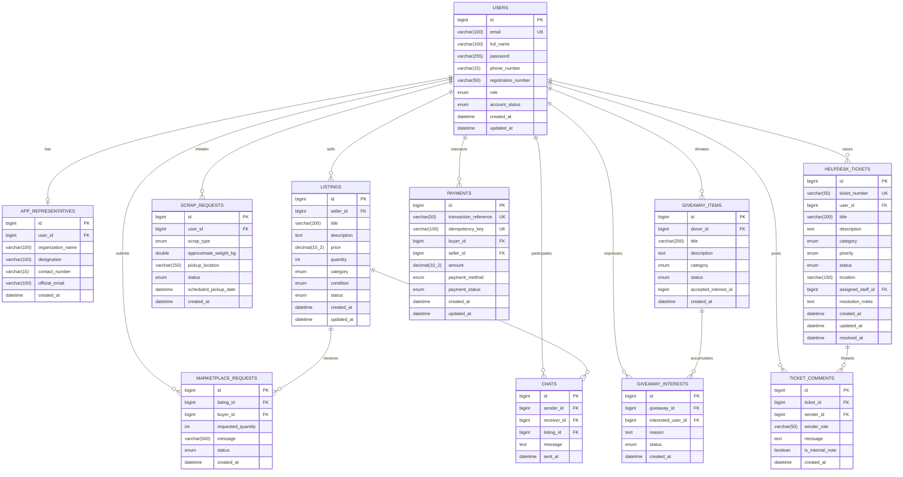

# Vendora Platform — Comprehensive Design Diagrams

This document contains the official architectural and design models for the **Vendora Microservices Ecosystem**, fulfilling the system design criteria:
1. **Use Case Diagram** (Actors, Subsystems, System Boundaries, Core Workflows)
2. **Class Diagram** (Entities, Attributes, Types, Methods, Enums, Relationships)
3. **Entity-Relationship (ER) Diagram** (Physical Database Schema, Tables, Keys, Cardinalities)

---

## 1. Use Case Diagram

The Use Case model maps the interactions between the 6 distinct campus user roles (**Student**, **Faculty**, **Resident**, **App Representative**, **Maintenance Staff**, **Administrator**) and the core microservice domains.

```mermaid
flowchart TD
    %% Actors
    subgraph Actors [Platform Actors]
        Student["fa:fa-user Student / Resident"]
        Admin["fa:fa-shield Admin"]
        Staff["fa:fa-wrench Maintenance Staff"]
        Rep["fa:fa-briefcase App Representative"]
    end

    %% Subsystems
    subgraph AuthSubsystem [1. Authentication & Identity]
        UC_Reg["Register Account (10-digit Phone, Strong Pwd)"]
        UC_Login["Login & Obtain JWT Token"]
        UC_Profile["View & Update Profile"]
        UC_Role["Update User Role (Admin Only)"]
    end

    subgraph MarketSubsystem [2. Peer-to-Peer Marketplace]
        UC_Listings["Browse Catalog (Multi-field Search)"]
        UC_CreateListing["Create / Manage Product Listing"]
        UC_RequestItem["Submit Purchase Request"]
        UC_Chat["Real-time Buyer-Seller Direct Chat"]
    end

    subgraph ScrapSubsystem [3. Scrap Collection & Giveaways]
        UC_ScrapReq["Schedule Bulk Scrap Pickup"]
        UC_GiveawayCreate["Post Free Giveaway Item"]
        UC_GiveawayInterest["Express Interest in Giveaway"]
        UC_GiveawayAccept["Accept & Award Giveaway Item"]
    end

    subgraph PaymentSubsystem [4. Payment & Settlement]
        UC_Pay["Process Payment (Idempotent Key)"]
        UC_PayStatus["Track Payment Status (Pending->Success->Refunded)"]
        UC_PayAudit["View Transaction History (Buyer/Seller)"]
    end

    subgraph HelpdeskSubsystem [5. Facilities Helpdesk]
        UC_TicketCreate["Raise Facility Ticket (AC, Lab, Wifi)"]
        UC_TicketAssign["Assign Technician (Admin / Staff)"]
        UC_TicketResolve["Progress & Resolve Ticket Lifecycle"]
        UC_TicketComment["Post Comment (Public vs Internal Note)"]
    end

    %% Student Relationships
    Student --> UC_Reg
    Student --> UC_Login
    Student --> UC_Profile
    Student --> UC_Listings
    Student --> UC_CreateListing
    Student --> UC_RequestItem
    Student --> UC_Chat
    Student --> UC_ScrapReq
    Student --> UC_GiveawayCreate
    Student --> UC_GiveawayInterest
    Student --> UC_Pay
    Student --> UC_PayAudit
    Student --> UC_TicketCreate
    Student --> UC_TicketComment

    %% Maintenance Staff Relationships
    Staff --> UC_Login
    Staff --> UC_TicketAssign
    Staff --> UC_TicketResolve
    Staff --> UC_TicketComment

    %% App Representative Relationships
    Rep --> UC_Login
    Rep --> UC_Listings
    Rep --> UC_ScrapReq

    %% Admin Relationships
    Admin --> UC_Login
    Admin --> UC_Role
    Admin --> UC_Profile
    Admin --> UC_TicketAssign
    Admin --> UC_TicketResolve
    Admin --> UC_PayStatus
```

---

## 2. Class Diagram (Domain Model)

The Domain Class Diagram represents the architectural entity classes, enums, encapsulation, field types, and relationships across the Vendora microservices.

```mermaid
classDiagram
    %% User Service Domain
    class User {
        +Long id
        +String fullName
        +String email
        +String password
        +String phoneNumber
        +Role role
        +String registrationNumber
        +AccountStatus accountStatus
        +LocalDateTime createdAt
        +LocalDateTime updatedAt
    }

    class AppRepresentative {
        +Long id
        +Long userId
        +String organizationName
        +String designation
        +String contactNumber
        +String officialEmail
        +LocalDateTime createdAt
    }

    class Role {
        <<enumeration>>
        STUDENT
        FACULTY
        RESIDENT
        APP_REPRESENTATIVE
        MAINTENANCE_STAFF
        COLLECTION_STAFF
        ADMIN
    }

    class AccountStatus {
        <<enumeration>>
        ACTIVE
        INACTIVE
        SUSPENDED
    }

    %% Marketplace Service Domain
    class Listing {
        +Long id
        +Long sellerId
        +String title
        +String description
        +BigDecimal price
        +ListingCategory category
        +ProductCondition condition
        +ListingStatus status
        +Integer quantity
        +LocalDateTime createdAt
        +LocalDateTime updatedAt
    }

    class MarketplaceRequest {
        +Long id
        +Long listingId
        +Long buyerId
        +Integer requestedQuantity
        +String message
        +RequestStatus status
        +LocalDateTime createdAt
    }

    class Chat {
        +Long id
        +Long senderId
        +Long receiverId
        +Long listingId
        +String message
        +LocalDateTime sentAt
    }

    class ListingCategory {
        <<enumeration>>
        TEXTBOOK
        ELECTRONICS
        STATIONERY
        FURNITURE
        CLOTHING
        OTHER
    }

    class ListingStatus {
        <<enumeration>>
        AVAILABLE
        RESERVED
        SOLD
        REMOVED
    }

    %% Scrap & Giveaway Domain
    class ScrapRequest {
        +Long id
        +Long userId
        +ScrapType scrapType
        +Double approximateWeightKg
        +String pickupLocation
        +ScrapStatus status
        +LocalDateTime scheduledPickupDate
        +LocalDateTime createdAt
    }

    class GiveawayItem {
        +Long id
        +Long donorId
        +String title
        +String description
        +GiveawayCategory category
        +GiveawayStatus status
        +Long acceptedInterestId
        +LocalDateTime createdAt
    }

    class GiveawayInterest {
        +Long id
        +Long giveawayId
        +Long interestedUserId
        +String reason
        +InterestStatus status
        +LocalDateTime createdAt
    }

    %% Payment Service Domain
    class Payment {
        +Long id
        +String transactionReference
        +String idempotencyKey
        +Long buyerId
        +Long sellerId
        +BigDecimal amount
        +PaymentMethod paymentMethod
        +PaymentStatus paymentStatus
        +LocalDateTime createdAt
        +LocalDateTime updatedAt
    }

    class PaymentStatus {
        <<enumeration>>
        PENDING
        SUCCESS
        FAILED
        REFUNDED
    }

    %% Helpdesk Service Domain
    class Ticket {
        +Long id
        +String ticketNumber
        +Long userId
        +String title
        +String description
        +TicketCategory category
        +TicketPriority priority
        +TicketStatus status
        +String location
        +Long assignedStaffId
        +String resolutionNotes
        +LocalDateTime createdAt
        +LocalDateTime updatedAt
        +LocalDateTime resolvedAt
    }

    class TicketComment {
        +Long id
        +Long ticketId
        +Long senderId
        +String senderRole
        +String message
        +Boolean isInternalNote
        +LocalDateTime createdAt
    }

    class TicketCategory {
        <<enumeration>>
        ELECTRICAL
        PLUMBING
        FURNITURE
        INTERNET_WIFI
        LAB_EQUIPMENT
        SANITATION
        AC_COOLING
        OTHER
    }

    class TicketPriority {
        <<enumeration>>
        LOW
        MEDIUM
        HIGH
        URGENT
    }

    class TicketStatus {
        <<enumeration>>
        OPEN
        ASSIGNED
        IN_PROGRESS
        RESOLVED
        CLOSED
        CANCELLED
    }

    %% Relationships
    User "1" --> "0..1" AppRepresentative : represents
    User "1" --> "0..*" Listing : sells
    User "1" --> "0..*" MarketplaceRequest : requests
    User "1" --> "0..*" Chat : sends / receives
    User "1" --> "0..*" ScrapRequest : books
    User "1" --> "0..*" GiveawayItem : donates
    User "1" --> "0..*" GiveawayInterest : submits
    User "1" --> "0..*" Payment : pays / receives
    User "1" --> "0..*" Ticket : creates
    User "0..1" --> "0..*" Ticket : assigned_to

    Listing "1" --> "0..*" MarketplaceRequest : receives
    Listing "1" --> "0..*" Chat : contextualizes

    GiveawayItem "1" --> "0..*" GiveawayInterest : receives

    Ticket "1" --> "0..*" TicketComment : contains
```

---

## 3. Entity-Relationship (ER) Diagram (Physical Schema)

This diagram reflects the physical relational tables, columns, data types, primary keys (`PK`), foreign keys (`FK`), and unique constraints (`UK`) in MySQL database **`vendora_db`**.

