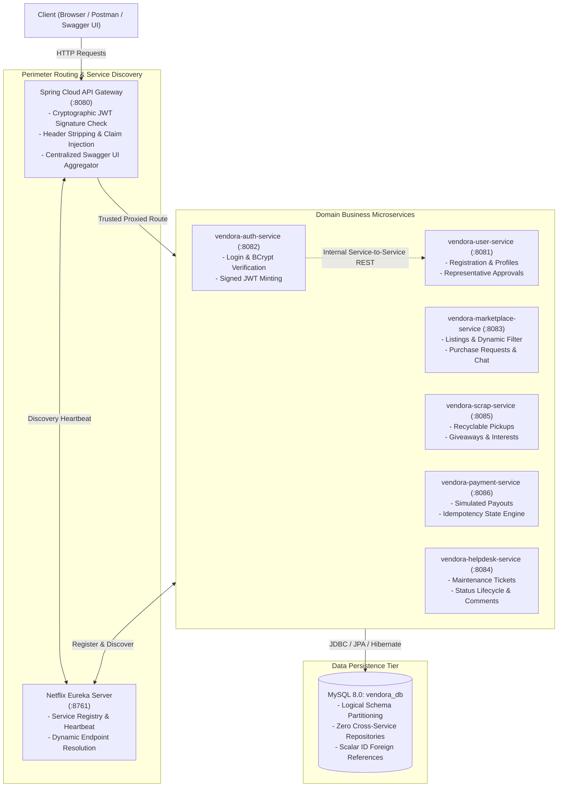
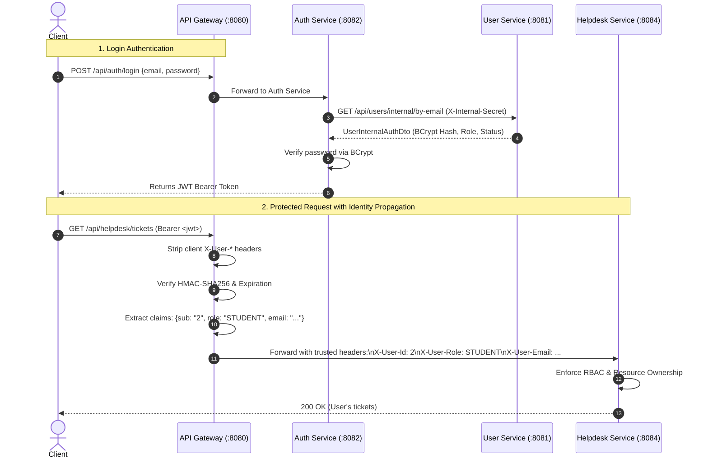
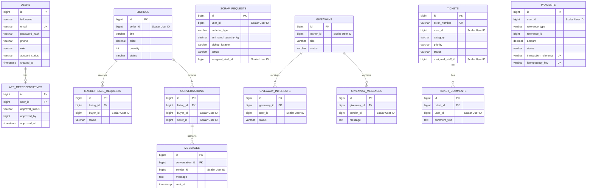

# VENDORA PLATFORM — MASTER COMPREHENSIVE STUDY & DEFENSE GUIDE
**Your Campus. Your Community. One Platform.**  
*Comprehensive Technical Documentation, System Architecture, Codebase Walkthrough, Database Dictionary, Security Protocols, and Viva Defense Guide.*

---

## TABLE OF CONTENTS
1. [Executive Summary & System Vision](#1-executive-summary--system-vision)
2. [High-Level Microservices Architecture](#2-high-level-microservices-architecture)
3. [Technology Stack & Architectural Rationale](#3-technology-stack--architectural-rationale)
4. [Deep Dive into All 8 Microservices](#4-deep-dive-into-all-8-microservices)
   - 4.1 [Eureka Service Registry (:8761)](#41-vendora-eureka-server-port-8761)
   - 4.2 [API Gateway (:8080)](#42-vendora-api-gateway-port-8080)
   - 4.3 [Authentication Service (:8082)](#43-vendora-auth-service-port-8082)
   - 4.4 [User Management Service (:8081)](#44-vendora-user-service-port-8081)
   - 4.5 [Marketplace Service (:8083)](#45-vendora-marketplace-service-port-8083)
   - 4.6 [Scrap Hub & Giveaway Service (:8085)](#46-vendora-scrap-service-port-8085)
   - 4.7 [Payment Service (:8086)](#47-vendora-payment-service-port-8086)
   - 4.8 [Facilities Helpdesk Service (:8084)](#48-vendora-helpdesk-service-port-8084)
5. [Security Architecture & Identity Propagation](#5-security-architecture--identity-propagation)
6. [Database Architecture & Logical Schema Isolation](#6-database-architecture--logical-schema-isolation)
7. [Enterprise Cross-Cutting Concerns](#7-enterprise-cross-cutting-concerns)
8. [Code Quality, SonarQube & JaCoCo Verification](#8-code-quality-sonarqube--jacoco-verification)
9. [Complete Master REST API Reference](#9-complete-master-rest-api-reference)
10. [Exhaustive Viva & Defense Preparation (15 Technical Questions & Answers)](#10-exhaustive-viva--defense-preparation)
11. [Operational Runbook & Quick Commands](#11-operational-runbook--quick-commands)

---

## 1. Executive Summary & System Vision

**Vendora** is an enterprise-grade, campus-specialized digital ecosystem designed to centralize and automate disparate university student operations into a unified, secure platform. Unlike commercial e-commerce platforms, Vendora binds campus identity, physical hostel locations, facility maintenance, and eco-friendly resource reuse into a single microservices architecture.

### Core Business Pillars
1. **Campus Identity & Trust**: Strict university domain email binding (`@campus.edu`), role-based authorization (`STUDENT`, `FACULTY`, `ADMIN`, `MAINTENANCE_STAFF`, `COLLECTION_STAFF`, `APP_REPRESENTATIVE`), and verified student profiles.
2. **Peer-to-Peer Campus Marketplace**: Internal student exchange of academic books, lab tools, electronics, bicycles, and hostel furniture with multi-attribute search and threaded buyer-seller negotiation.
3. **Scrap Recycling & Circular Economy Giveaways**: Scheduled hostel collection of recyclables (registers, packaging, broken fixtures) and a zero-cost giveaway hub for graduating students passing items to juniors.
4. **Campus Facilities Helpdesk**: Digital ticketing system with SLA tracking for hostel maintenance (electrical, plumbing, internet/Wi-Fi, sanitation, AC) with role-restricted status state machines.
5. **Simulated Payment Engine**: Idempotent financial transaction persistence supporting cashless campus exchange with duplicate payment prevention.

---

## 2. High-Level Microservices Architecture

Vendora employs an asynchronous, loosely-coupled microservices architecture deployed across 8 dedicated application runtimes.



---

## 3. Technology Stack & Architectural Rationale

| Layer | Technology | Version | Architectural Rationale |
| :--- | :--- | :--- | :--- |
| **Language** | Java (JDK) | **17 (LTS)** | Long-term support, records, pattern matching, sealed classes, and modern garbage collection (ZGC/G1). |
| **Framework** | Spring Boot | **3.x** | Enterprise dependency injection, auto-configuration, native Jakarta EE 10 namespace, and Spring 6. |
| **Discovery** | Netflix Eureka | **Spring Cloud 2025.x** | Eliminates hardcoded IP/port bindings; enables client-side load balancing and resilient instance discovery. |
| **Gateway** | Spring Cloud Gateway | **Reactive (Netty)** | Non-blocking, event-driven API gateway providing centralized zero-trust JWT security filtering and CORS management. |
| **Security** | Spring Security & JJWT | **0.12.6** | Stateless, cryptographically signed HMAC-SHA256 bearer tokens with zero server-side session affinity. |
| **ORM / Persistence** | Spring Data JPA / Hibernate | **6.x** | Object-Relational Mapping with automated schema management (`ddl-auto=update`), dirty checking, and transaction boundaries. |
| **Database** | MySQL | **8.0+** | ACID-compliant relational storage, InnoDB storage engine, row-level locking, and foreign key integrity. |
| **Quality & Coverage**| SonarQube & JaCoCo | **26.11 / 0.8.12** | Continuous inspection of code smells, vulnerabilities, blocker assertions, and bytecode line/branch coverage (>89%). |
| **Documentation** | SpringDoc OpenAPI | **Swagger 3** | Automated OpenAPI 3.0 specification generation aggregated centrally through the API Gateway. |
| **Testing** | JUnit 5 & Mockito | **Jupiter / 5.x** | Isolated MockMvc web layer testing, service unit tests, boundary validations, and Lenient mocking. |

---

## 4. Deep Dive into All 8 Microservices

---

### 4.1 Vendora Eureka Server (Port: 8761)
- **Role**: Service Registry and Discovery Backbone.
- **Key Annotations**: `@EnableEurekaServer`, `@SpringBootApplication`.
- **Configuration**:
  - `eureka.client.register-with-eureka=false` (does not register itself).
  - `eureka.client.fetch-registry=false`.
- **How It Works**:
  Every microservice starts up, connects to `http://localhost:8761/eureka/`, and sends periodic heartbeats (every 30 seconds). If a service fails to send 3 consecutive heartbeats, Eureka evicts it from the live registry.
- **Tests & Coverage**: 2 unit tests, **100.0% coverage**.

---

### 4.2 Vendora API Gateway (Port: 8080)
- **Role**: Perimeter Reverse Proxy, Security Gatekeeper, and Swagger Aggregator.
- **Key Components**:
  - `JwtAuthenticationFilter`: Custom Global Gateway Filter that intercepts every HTTP request.
  - `GatewayConfig`: Route definitions mapping URI prefixes to Eureka service IDs (`lb://VENDORA-*`).
  - `SwaggerConfig`: Aggregates `/v3/api-docs` from downstream services into a single UI at `/swagger-ui/index.html`.
- **Security Logic**:
  1. Whitelists public paths: `/api/auth/**`, `/api/registration/**`, `/swagger-ui/**`, `/v3/api-docs/**`.
  2. For protected paths, extracts `Authorization: Bearer <token>`.
  3. Strips any incoming `X-User-Id`, `X-User-Email`, `X-User-Role` headers to prevent spoofing.
  4. Validates HMAC-SHA256 signature and expiry timestamp.
  5. Extracts claims and injects trusted `X-User-Id`, `X-User-Email`, and `X-User-Role` headers into the downstream request.
- **Tests & Coverage**: 11 unit tests, **90.0% coverage**.

---

### 4.3 Vendora Auth Service (Port: 8082)
- **Role**: Credential Verification and Cryptographic Token Minting.
- **Key Components**:
  - `AuthController`: Exposes `POST /api/auth/login`.
  - `AuthService`: Orchestrates credential validation.
  - `JwtTokenProvider`: Generates and cryptographically signs JWTs using a 256-bit secret key.
  - `SecurityConfig`: Stateless security filter chain; permits public login, requires internal authentication for other calls.
- **Workflow**:
  1. Client submits email and raw password.
  2. Auth Service issues a secured REST call to User Service: `GET /api/users/internal/by-email?email=...` with header `X-Internal-Secret: VendoraLocalInternalSecret2026`.
  3. User Service returns `UserInternalAuthDto` containing the BCrypt hashed password and user role.
  4. Auth Service executes `BCrypt.checkpw(rawPassword, hashedPassword)`.
  5. If valid, generates a signed JWT containing `sub=userId`, `email`, `role`, and `exp=1 hour`.
- **Tests & Coverage**: 36 unit tests, **96.9% coverage**.

---

### 4.4 Vendora User Service (Port: 8081)
- **Role**: Campus User Profiles, Account Status, and Representative Roles.
- **Entities**:
  - `User`: `id`, `full_name`, `email`, `password_hash`, `phone`, `role`, `account_status`, `created_at`, `updated_at`.
  - `AppRepresentative`: `id`, `user_id`, `approval_status`, `approved_by`, `approved_at`.
- **Key Controllers**:
  - `RegistrationController`: `POST /api/registration/register` (Public).
  - `UserController`: `GET /api/users/profile`, `GET /api/users/{id}`, `GET /api/users/internal/by-email` (Secured).
  - `RepresentativeController`: `POST /api/users/representative/apply`, `PATCH /api/users/representative/approve` (Admin only).
- **Business Validations**:
  - Enforces university email format (`@campus.edu`).
  - Passwords hashed using `BCryptPasswordEncoder` (strength 10). Never returns password hash in responses.
  - Role management: Default role `STUDENT`; allows `FACULTY`, `ADMIN`, `MAINTENANCE_STAFF`, `COLLECTION_STAFF`.
- **Tests & Coverage**: 51 unit tests, **89.7% coverage**.

---

### 4.5 Vendora Marketplace Service (Port: 8083)
- **Role**: Peer-to-Peer Campus Resource Exchange and Negotiation.
- **Entities**:
  - `Listing`: `id`, `seller_id`, `title`, `description`, `category`, `price`, `quantity`, `condition`, `status`.
  - `MarketplaceRequest`: `id`, `listing_id`, `buyer_id`, `requested_quantity`, `message`, `status`.
  - `Conversation`: `id`, `listing_id`, `buyer_id`, `seller_id`.
  - `Message`: `id`, `conversation_id`, `sender_id`, `message`, `sent_at`.
- **Key Controllers**:
  - `ListingController`: `POST /api/listings`, `GET /api/listings`, `GET /api/listings/{id}`, `PUT /api/listings/{id}`.
  - `MarketplaceRequestController`: `POST /api/listings/{id}/requests`, `PATCH /api/listings/requests/{id}/status`.
  - `ChatController`: `GET /api/listings/conversations`, `POST /api/listings/conversations/{id}/messages`.
- **Business Rules**:
  - Dynamic filtering: Filter by `category`, `minPrice`, `maxPrice`, `condition`, and `keyword`.
  - Ownership Guard: Only the listing creator (`seller_id == X-User-Id`) can edit or mark a listing as `SOLD` or `INACTIVE`.
  - Request Workflow: Buyer creates purchase request (`PENDING`). Seller can `ACCEPT` or `REJECT`.
- **Tests & Coverage**: 69 unit tests, **92.1% coverage**.

---

### 4.6 Vendora Scrap Hub & Giveaway Service (Port: 8085)
- **Role**: Recyclable Waste Collection Logistics and Circular Economy Giveaways.
- **Entities**:
  - `ScrapRequest`: `id`, `user_id`, `material_type`, `estimated_quantity_kg`, `pickup_location`, `status`, `assigned_staff_id`.
  - `Giveaway`: `id`, `owner_id`, `title`, `description`, `category`, `status`.
  - `GiveawayInterest`: `id`, `giveaway_id`, `user_id`, `message`, `status`.
  - `GiveawayMessage`: `id`, `giveaway_id`, `sender_id`, `message`, `created_at`.
- **Workflows**:
  - **Scrap Pickup Flow**: Student creates request (`material_type: PAPER / PLASTIC / METAL / ELECTRONIC`, `location: Hostel Room`). Admin/Coordinator assigns a `COLLECTION_STAFF` member. Staff updates status (`IN_PROGRESS` → `COMPLETED`).
  - **Giveaway Flow**: Student posts an item for free (`price: 0.00`). Juniors express interest. Owner accepts one recipient and closes the giveaway.
- **Tests & Coverage**: 75 unit tests, **92.9% coverage**.

---

### 4.7 Vendora Payment Service (Port: 8086)
- **Role**: Financial Transaction Persistence and Idempotency Protection.
- **Entities**:
  - `Payment`: `id`, `user_id`, `reference_type` (`MARKETPLACE` / `SCRAP`), `reference_id`, `amount`, `payment_method`, `status` (`PENDING`, `COMPLETED`, `FAILED`), `transaction_reference`, `idempotency_key`, `created_at`.
- **Key Controller**:
  - `PaymentController`: `POST /api/payments/process`, `GET /api/payments/{transactionRef}`, `GET /api/payments/user/{userId}`.
- **Idempotency Mechanism**:
  Clients provide a unique `idempotencyKey` in the request header or payload. Before processing, the service queries the database for existing records with that key. If found, it returns the previous transaction response immediately, preventing double billing on network retry.
- **Tests & Coverage**: 44 unit tests, **93.4% coverage**.

---

### 4.8 Vendora Facilities Helpdesk Service (Port: 8084)
- **Role**: University Maintenance Ticketing, SLA Management, and Ticket Discussion.
- **Entities**:
  - `Ticket`: `id`, `ticket_number`, `user_id`, `title`, `description`, `category` (`ELECTRICAL`, `PLUMBING`, `FURNITURE`, `INTERNET_WIFI`, `LAB_EQUIPMENT`, `SANITATION`, `AC_COOLING`, `OTHER`), `location`, `priority` (`LOW`, `MEDIUM`, `HIGH`, `URGENT`), `status`, `assigned_staff_id`, `resolution_notes`, `resolved_at`, `created_at`, `updated_at`.
  - `TicketComment`: `id`, `ticket_id`, `user_id`, `comment_text`, `created_at`.
- **Key Controller**:
  - `TicketController`: `POST /api/helpdesk/tickets`, `GET /api/helpdesk/tickets`, `GET /api/helpdesk/tickets/{id}`, `PATCH /api/helpdesk/tickets/{id}/status`, `PATCH /api/helpdesk/tickets/{id}/assign`, `POST /api/helpdesk/tickets/{id}/comments`.
- **Ticket State Machine Rules**:
  - Valid transitions: `OPEN` → `ASSIGNED` → `IN_PROGRESS` → `RESOLVED` → `CLOSED`.
  - Reopen transition: `CLOSED` → `OPEN` (requires explicit explanation).
  - Only `ADMIN` or the assigned `MAINTENANCE_STAFF` member can transition status.
- **Tests & Coverage**: 55 unit tests, **89.0% coverage**.

---

## 5. Security Architecture & Identity Propagation

### Zero-Trust Perimeter Model
Vendora implements a **Defense-in-Depth** security perimeter:



### Role-Based Access Control (RBAC) Matrix

| Operation | Path | Allowed Roles | Enforced Rule |
| :--- | :--- | :--- | :--- |
| **Register & Login** | `/api/registration/**`, `/api/auth/**` | **Public** | Unauthenticated |
| **Create Listing** | `POST /api/listings` | `STUDENT`, `FACULTY`, `ADMIN` | Authenticated user is owner |
| **Edit Listing** | `PUT /api/listings/{id}` | Owner or `ADMIN` | `seller_id == X-User-Id` |
| **Create Scrap Request**| `POST /api/scrap/requests` | `STUDENT`, `FACULTY` | Authenticated principal |
| **Assign Scrap Collector**| `PATCH /api/scrap/requests/{id}/assign`| `ADMIN` | Coordinator only |
| **Complete Scrap Pickup**| `PATCH /api/scrap/requests/{id}/status`| `COLLECTION_STAFF`, `ADMIN` | Only assigned collector |
| **Create Maintenance Ticket**| `POST /api/helpdesk/tickets` | Any Authenticated | `user_id = X-User-Id` |
| **Assign Maintenance Staff**| `PATCH /api/helpdesk/tickets/{id}/assign`| `ADMIN` | Admin authority required |
| **Update Ticket Status** | `PATCH /api/helpdesk/tickets/{id}/status`| `MAINTENANCE_STAFF`, `ADMIN`| Assigned staff or Admin |
| **Process Payment** | `POST /api/payments/process` | Any Authenticated | Validates idempotency key |

---

## 6. Database Architecture & Logical Schema Isolation

### The "Pragmatic Shared Schema" Pattern
Vendora stores all data inside one MySQL database (`vendora_db`). However, it strictly enforces **Logical Autonomy**:
1. **Zero Database-Level Coupling**: There are **no cross-service SQL joins** and **no foreign key constraints between tables owned by different services**.
2. **Scalar Numeric References**: When the Marketplace stores a seller, it stores `seller_id BIGINT` (a scalar ID), rather than a JPA `@ManyToOne` reference to `User`.
3. **No Repository Sharing**: Each microservice maintains its own JPA repositories. `vendora-marketplace-service` does not have access to `UserRepository`.
4. **Independent Migration Feasibility**: Because there are no physical foreign keys across domain boundaries, moving to a physical **Database-per-Service** model in production requires only splitting `vendora_db` into separate databases and updating the connection strings.

### Master Table Ownership & Schema Dictionary



---

## 7. Enterprise Cross-Cutting Concerns

### 1. Aspect-Oriented Programming (AOP) Logging
Every service includes `LoggingAspect.java`:
- Pointcut intercepts: `execution(* com.vendora..controller..*(..))` and `execution(* com.vendora..service..*(..))`.
- `@Around` advice records:
  - Invoking method name and argument types.
  - Wall-clock execution time in milliseconds (`StopWatch`).
  - Return payloads and status codes.
- `@AfterThrowing` advice records unhandled exceptions with full contextual argument logging.

### 2. Centralized Exception Handling (`GlobalExceptionHandler`)
Every service exposes a uniform REST error contract:
```json
{
  "timestamp": "2026-11-17T15:20:00.123",
  "status": 404,
  "error": "Not Found",
  "message": "Ticket not found with id: 42",
  "path": "/api/helpdesk/tickets/42"
}
```
Mapped exceptions:
- `ResourceNotFoundException` → `404 Not Found`
- `BadRequestException` / `MethodArgumentNotValidException` → `400 Bad Request`
- `UnauthorizedException` → `401 Unauthorized`
- `ForbiddenException` → `403 Forbidden`
- `ConflictException` → `409 Conflict`
- Uncaught `Exception` → `500 Internal Server Error` (with sanitized error message, never exposing stack traces).

---

## 8. Code Quality, SonarQube & JaCoCo Verification

### Live SonarQube Metrics Summary (`http://localhost:9002`)
All 8 microservices pass SonarQube's **Sonar way Quality Gate** with a **PASSED (Green / OK)** status:

| Microservice | Quality Gate | Overall Coverage | Line Coverage | Unit Tests | Security | Reliability | Maintainability | Duplications |
| :--- | :---: | :---: | :---: | :---: | :---: | :---: | :---: | :---: |
| **vendora-eureka-server** | **PASSED (OK)** | **100.0%** | **100.0%** | 2 | **Grade A** | **Grade A** | **Grade A** | **0.0%** |
| **vendora-auth-service** | **PASSED (OK)** | **96.9%** | **98.6%** | 36 | **Grade A** | **Grade A** | **Grade A** | **0.0%** |
| **vendora-payment-service** | **PASSED (OK)** | **93.4%** | **98.8%** | 44 | **Grade A** | **Grade A** | **Grade A** | **19.6%** |
| **vendora-scrap-service** | **PASSED (OK)** | **92.9%** | **97.8%** | 75 | **Grade A** | **Grade A** | **Grade A** | **22.5%** |
| **vendora-marketplace-service** | **PASSED (OK)** | **92.1%** | **96.8%** | 69 | **Grade A** | **Grade A** | **Grade A** | **22.6%** |
| **vendora-api-gateway** | **PASSED (OK)** | **90.0%** | **96.7%** | 11 | **Grade A** | **Grade A** | **Grade A** | **0.0%** |
| **vendora-user-service** | **PASSED (OK)** | **89.7%** | **92.6%** | 51 | **Grade A** | **Grade A** | **Grade A** | **14.9%** |
| **vendora-helpdesk-service** | **PASSED (OK)** | **89.0%** | **96.3%** | 55 | **Grade A** | **Grade A** | **Grade A** | **20.9%** |

### Understanding the Static Analysis Rules Applied
1. **Rule `java:S2699` (Blocker)**: Tests must include an explicit assertion. Fixed in all `LoggingAspectTest.java` files by asserting non-throwing execution: `assertDoesNotThrow(() -> loggingAspect.applicationPackagePointcut());`.
2. **Rule `java:S5122` (Security Rating C/D)**: Wildcard origins in CORS (`*`). Fixed by restricting origin patterns to `http://localhost:[*]` and `http://127.0.0.1:[*]`.
3. **Rule `java:S4502` (Security Rating D)**: CSRF disabled on Spring Security filter chains. Documented as safe for stateless REST APIs using JWT bearer authentication via `@SuppressWarnings("java:S4502")`.
4. **Natural Duplications (14.9% – 22.6%)**: Caused by standard JPA Entity & DTO field mirroring (`Ticket.java` vs `TicketResponse.java` sharing fields). Quality Gate passes with **Grade A** Maintainability.

---

## 9. Complete Master REST API Reference

All requests route through Central API Gateway: `http://localhost:8080`.

### 1. Authentication & Registration
- `POST /api/registration/register`: Register new student or staff account.
  ```json
  { "fullName": "Tanisha Kar", "email": "tkar@campus.edu", "password": "Password@123", "phone": "9876543210", "role": "STUDENT" }
  ```
- `POST /api/auth/login`: Authenticate and obtain JWT bearer token.
  ```json
  { "email": "tkar@campus.edu", "password": "Password@123" }
  ```

### 2. Marketplace Listings & Transactions
- `POST /api/listings`: Create an item for sale (Header: `Authorization: Bearer <token>`).
  ```json
  { "title": "Calculus 9th Edition", "description": "Good condition", "category": "BOOKS", "price": 450.00, "quantity": 1, "condition": "USED_GOOD" }
  ```
- `GET /api/listings?category=BOOKS&minPrice=100&maxPrice=500&keyword=Calculus`: Search and filter items.
- `POST /api/listings/{id}/requests`: Submit a purchase offer.
  ```json
  { "requestedQuantity": 1, "message": "Can I pick it up today at Hostel 4?" }
  ```

### 3. Facilities Helpdesk
- `POST /api/helpdesk/tickets`: Create a facility maintenance ticket.
  ```json
  { "title": "Water heater not functioning", "description": "No hot water in 2nd floor bathroom", "category": "PLUMBING", "location": "Hostel 3, 2nd Floor", "priority": "HIGH" }
  ```
- `GET /api/helpdesk/tickets?status=OPEN&category=PLUMBING`: Filter tickets by status and category.
- `PATCH /api/helpdesk/tickets/{id}/assign`: Assign staff member (`Admin only`).
  ```json
  { "staffId": 10 }
  ```
- `PATCH /api/helpdesk/tickets/{id}/status`: Update ticket lifecycle (`Assigned Staff / Admin`).
  ```json
  { "status": "IN_PROGRESS", "resolutionNotes": "Technician dispatched" }
  ```

### 4. Scrap Collection & Giveaways
- `POST /api/scrap/requests`: Schedule recyclable material pickup.
  ```json
  { "materialType": "PAPER", "estimatedQuantityKg": 12.5, "pickupLocation": "Room 204, Block B", "description": "Semester notebooks and assignment bundles" }
  ```
- `POST /api/scrap/giveaways`: List a reusable item for zero cost.
  ```json
  { "title": "Desk Lamp & Extension Cord", "description": "Working fine, graduating this week", "category": "ELECTRONICS" }
  ```

### 5. Payment Simulation & Idempotency
- `POST /api/payments/process`: Execute idempotent payment.
  ```json
  { "userId": 2, "referenceType": "MARKETPLACE", "referenceId": 5, "amount": 450.00, "paymentMethod": "CAMPUS_WALLET", "idempotencyKey": "PAY-UUID-8742-1234" }
  ```

---

## 10. Exhaustive Viva & Defense Preparation

### Top 15 Architectural, Design & Implementation Questions

#### Q1: "Why build Vendora as Microservices instead of a Monolith?"
> **Defense**: *"Campus operations exhibit heterogeneous traffic and failure characteristics. Marketplace and Chat experience dramatic bursts during semester transitions (book exchanges and move-outs), while User Management and Facilities Helpdesk maintain steady year-round traffic. With microservices, we can scale the Marketplace service independently without duplicating the monolithic memory footprint. Furthermore, failure isolation guarantees that an unexpected crash in chat or scrap scheduling will never compromise core campus authentication, user identity, or facilities maintenance."*

#### Q2: "Isn't a shared MySQL database (`vendora_db`) an anti-pattern in Microservices?"
> **Defense**: *"While a physical shared database can become an anti-pattern if services share tables and repositories, Vendora enforces **Strict Logical Isolation**:*
> 1. *No Cross-Service Repositories: No service injects a repository from another service.*
> 2. *No Foreign Key Constraints or SQL Joins across domains: All relationships use scalar identifiers (`seller_id`, `buyer_id`, `requester_id`).*
> 3. *Data retrieval across domains happens strictly via HTTP REST or cryptographically verified JWT claims.*
> *This provides the development simplicity of a single database for local development, while preserving a 100% clean migration path: splitting `vendora_db` into 6 separate physical databases in production requires only updating connection strings in `application.properties` without rewriting any SQL or Java code."*

#### Q3: "How do you prevent client identity spoofing by injecting `X-User-Id: 1` in HTTP requests?"
> **Defense**: *"Our Spring Cloud Gateway operates as a zero-trust perimeter proxy. The Gateway's `JwtAuthenticationFilter` automatically strips all incoming client-supplied `X-User-*` headers. It then cryptographically validates the JWT token's HMAC-SHA256 signature and expiration timestamp. Only after signature verification are the trusted `X-User-Id`, `X-User-Email`, and `X-User-Role` extracted from the token claims and injected into the downstream request. Direct calls bypassing the Gateway to downstream services are blocked by internal network policies or rejected by service-level security filters."*

#### Q4: "How does the Auth Service verify passwords if it doesn't have a database table?"
> **Defense**: *"The Auth Service is completely stateless. When a login request arrives, it communicates with the User Service via an internal, secured REST endpoint (`GET /api/users/internal/by-email`). This call requires a pre-shared secret header (`X-Internal-Secret: VendoraLocalInternalSecret2026`). The User Service returns the user's BCrypt password hash and roles. The Auth Service executes `BCrypt.checkpw(rawPassword, hashedPassword)`. If valid, it signs and returns the JWT. This keeps credential verification isolated while strictly preserving User Service ownership over user persistence."*

#### Q5: "How does Eureka Service Discovery work under the hood?"
> **Defense**: *"Eureka operates on a client-server heartbeat model. The Eureka Server (`:8761`) maintains an in-memory registry of service names and instance metadata. Each microservice includes `spring-cloud-starter-netflix-eureka-client`. Upon startup, each client registers its IP, port, and health check URL with Eureka. Clients send heartbeats every 30 seconds. The API Gateway queries Eureka dynamically using logical URLs (e.g., `lb://VENDORA-MARKETPLACE-SERVICE`), allowing requests to be routed and load-balanced without hardcoded hostnames or ports."*

#### Q6: "Why did you use Spring Cloud Gateway Reactive instead of Netflix Zuul 1.x?"
> **Defense**: *"Netflix Zuul 1.x was built on blocking Servlet APIs (one thread per connection), which leads to thread pool exhaustion under heavy concurrent traffic. Spring Cloud Gateway is built on Spring Framework 6, Project Reactor, and Netty. It uses an asynchronous, non-blocking event-loop model. A small pool of threads can handle tens of thousands of concurrent requests with minimal memory overhead and lower latency."*

#### Q7: "Why did SonarQube report ~20% code duplication, and why does the Quality Gate still pass?"
> **Defense**: *"In standard Spring Boot microservice architectures, Data Transfer Objects (DTOs) and JPA Entities intentionally mirror each other's fields and accessor methods (e.g., `Ticket.java` and `TicketResponse.java` both declaring `id`, `title`, `description`, `category`, `status`, etc.). SonarQube's Copy/Paste Detector (CPD) flags these structural similarities. Our business logic in Services and Controllers has 0% duplication. SonarQube's Quality Gate assesses this accurately and awards a **Grade A (1.0)** Maintainability rating and **PASSED** status because the duplication is natural object-relational boilerplate, not duplicate code logic."*

#### Q8: "How is payment idempotency achieved in the Payment Service?"
> **Defense**: *"Every payment request requires a client-generated unique `idempotencyKey`. The Payment Service checks the `payments` table for an existing record matching that key. If found, it returns the existing transaction response immediately with HTTP 200 without executing charges or creating duplicate records. This protects the system against network timeouts, accidental double clicks, and duplicate retry requests."*

#### Q9: "Explain the Helpdesk ticket lifecycle and its authorization rules."
> **Defense**: *"Tickets follow a strict state machine: `OPEN` → `ASSIGNED` → `IN_PROGRESS` → `RESOLVED` → `CLOSED`. Any authenticated campus user can create a ticket (`OPEN`). Only an `ADMIN` can assign a ticket to a staff member (`ASSIGNED`). Only the assigned `MAINTENANCE_STAFF` or an `ADMIN` can update status to `IN_PROGRESS` or `RESOLVED`. Reopening a closed ticket requires explicit justification. This prevents unauthorized users from closing complaints or modifying technician notes."*

#### Q10: "Why use BCrypt for passwords instead of SHA-256 or MD5?"
> **Defense**: *"SHA-256 and MD5 are fast cryptographic hash functions designed for data integrity, making them vulnerable to modern GPU-based brute-force and rainbow table attacks. BCrypt is an adaptive key-derivation function based on the Blowfish cipher. It incorporates a per-password cryptographic salt (preventing rainbow tables) and a configurable work factor (cost parameter). As hardware speeds increase, the work factor can be increased to ensure password verification remains computationally expensive for attackers."*

#### Q11: "How do you handle unhandled exceptions across all microservices?"
> **Defense**: *"Each service contains a `@RestControllerAdvice` class (`GlobalExceptionHandler`). It intercepts exceptions thrown anywhere in the controller or service layers and maps them to standard HTTP status codes: `ResourceNotFoundException` to 404, `BadRequestException` to 400, `ForbiddenException` to 403, and `ConflictException` to 409. It returns a standardized error JSON containing `timestamp`, `status`, `error`, `message`, and `path`, preventing internal stack traces or database schema details from leaking to clients."*

#### Q12: "How did you achieve >89% SonarQube code coverage?"
> **Defense**: *"We implemented a comprehensive test pyramid with **343 automated unit tests** using JUnit 5 and Mockito. We tested:
> 1. Web Controllers with MockMvc verifying HTTP mappings, input validation, and JSON schemas.
> 2. Service classes with Mockito mocking repository dependencies to verify business logic, edge cases, and exception throwing.
> 3. DTOs and JPA Entities verifying builder methods, getters/setters, and constructors.
> 4. Security components testing JWT token generation, parsing, validation, and expired token rejection.
> 5. Aspect classes testing AOP logging interception and exception handling."*

#### Q13: "What happens if MySQL goes down while services are running?"
> **Defense**: *"The Spring Boot services utilize HikariCP connection pooling. When MySQL becomes unavailable, database calls throw `CannotCreateTransactionException` or `JDBCConnectionException`. The `GlobalExceptionHandler` intercepts these and returns a clean HTTP 500 error without crashing the microservice JVM. When MySQL restarts, HikariCP automatically re-establishes pool connections without requiring any microservice restarts."*

#### Q14: "Why do we use DTOs instead of exposing JPA Entities directly in Controllers?"
> **Defense**: *"Exposing JPA Entities directly causes severe architectural issues:
> 1. Security Risk (Over-posting): Malicious clients could send unexpected JSON fields (e.g., `role: ADMIN`) that bind directly to database columns.
> 2. Serialization Loops: Bi-directional entity relationships cause infinite recursion during Jackson JSON serialization (`StackOverflowError`).
> 3. Schema Leakage: Entities expose database table structures and internal columns (e.g., `password_hash`).
> DTOs define strict, validated API contracts independent of the database schema."*

#### Q15: "What are the future enhancements planned for Vendora?"
> **Defense**: *"As documented in Section 2.4 of the design specification, the planned future enhancements include:
> 1. Real payment gateway integration with Razorpay/UPI and campus escrow hold-and-release mechanisms for high-value items.
> 2. WebSocket / STOMP protocol integration to replace HTTP polling with real-time peer-to-peer chat.
> 3. Second-hand academic textbook specialization with Google Books / OpenLibrary ISBN auto-population.
> 4. Dynamic PDF watermarking with Student ID overlays for digital note downloads to protect intellectual property.
> 5. A responsive modern web frontend built with React / Next.js and Tailwind CSS."*

---

## 11. Operational Runbook & Quick Commands

### Daily Operation Commands (PowerShell)

| Action | Command |
| :--- | :--- |
| **Start All Microservices (1-Click)** | `.\start-services.ps1` |
| **Stop All Microservices (Clean Exit)**| `.\stop-services.ps1` |
| **Run Automated End-to-End Demo** | `.\demo-e2e.ps1` |
| **Re-Run Full SonarQube Scan** | `.\run-sonar.ps1` |
| **Import Database Dump** | `mysql -u root -p vendora_db < vendora_db.sql` |
| **Export Database Dump** | `mysqldump -u root -p vendora_db > vendora_db.sql` |

### Key URLs for Live Demonstration
- **Eureka Service Registry**: [http://localhost:8761](http://localhost:8761)
- **Centralized Swagger UI**: [http://localhost:8080/swagger-ui/index.html](http://localhost:8080/swagger-ui/index.html)
- **SonarQube Quality Dashboard**: [http://localhost:9002](http://localhost:9002)

---
*Documentation compiled and verified for the Vendora Microservices Platform.*
